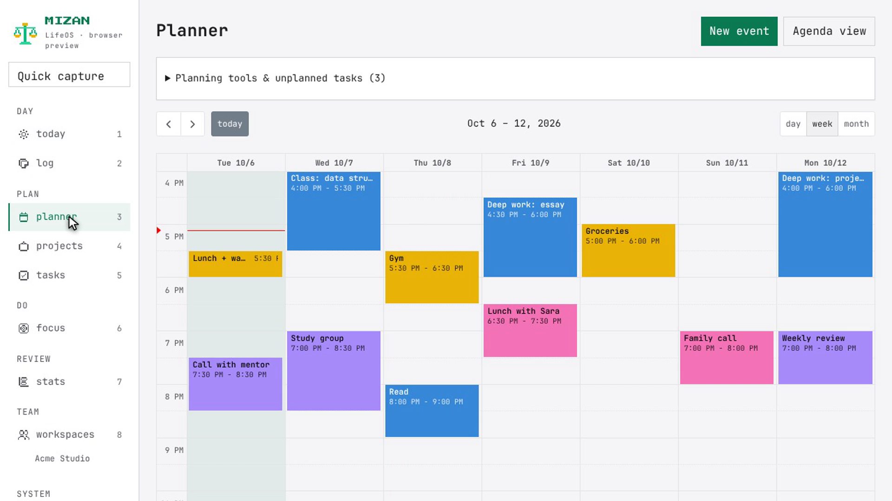
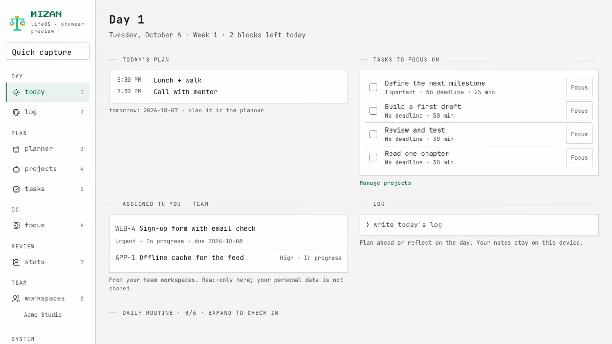
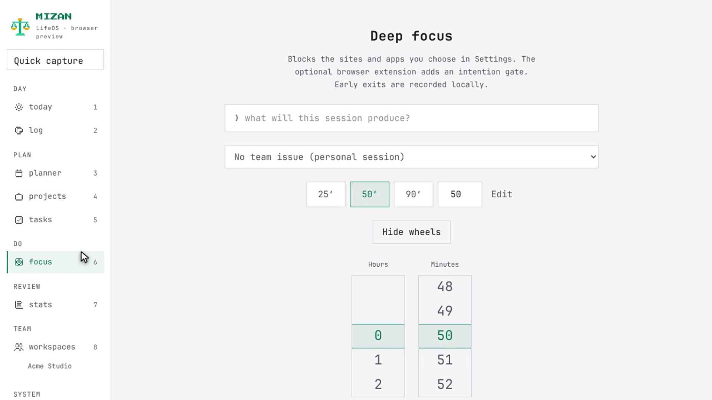
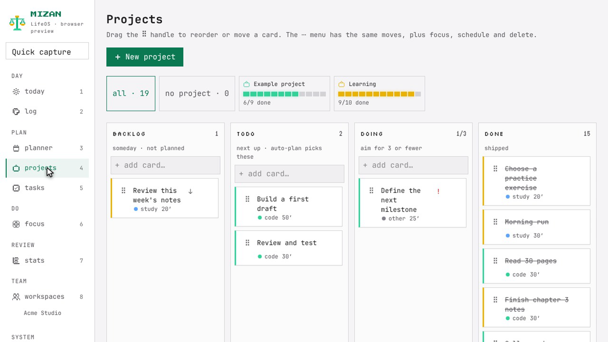
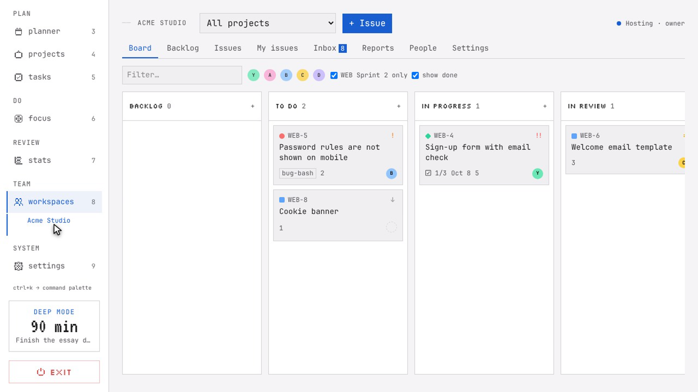
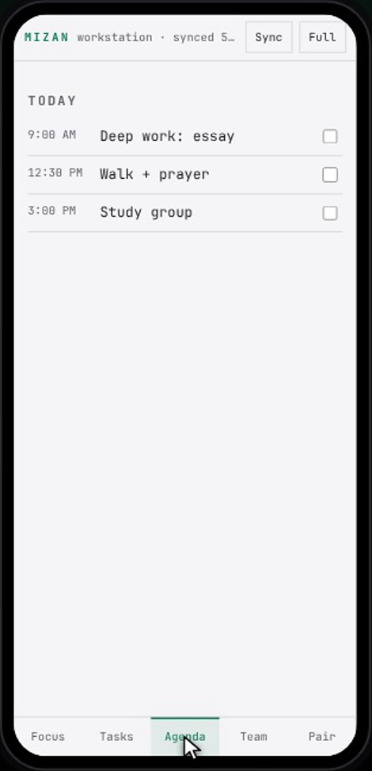
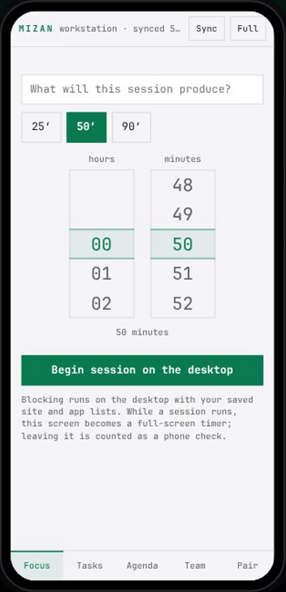
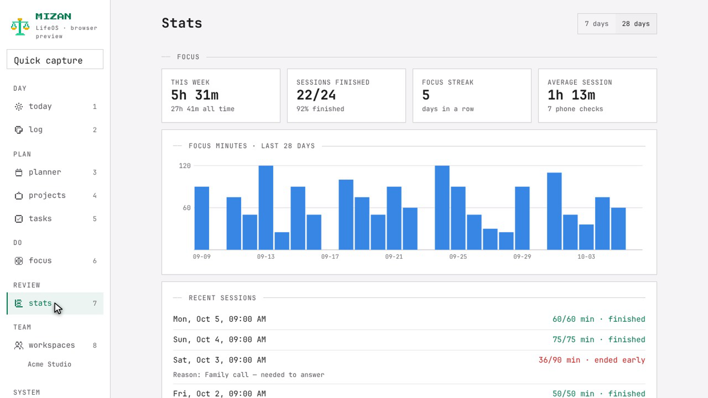
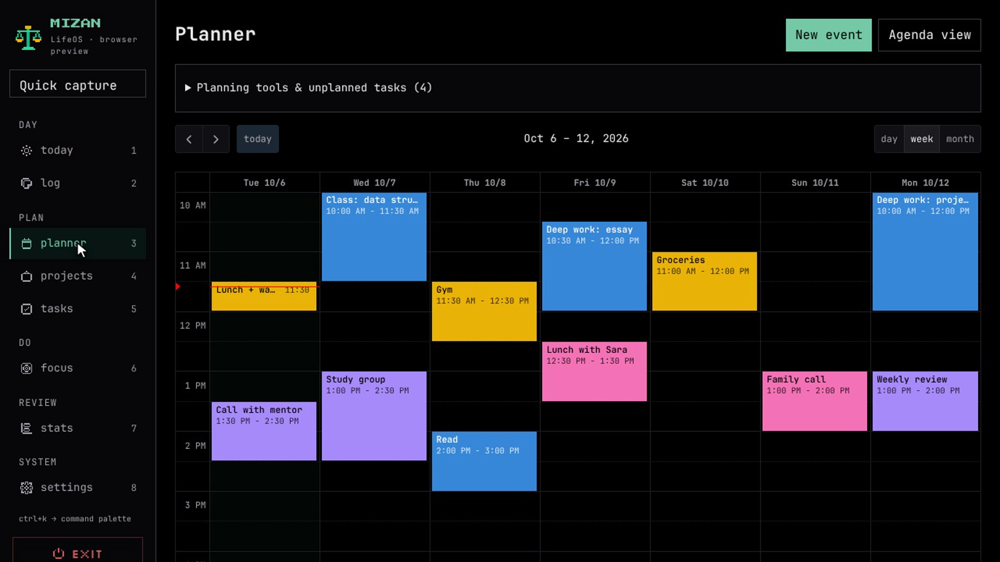

# <p align="center"><br>Mizan LifeOS</p>

<p align="center">
  <b>A calm, local-first personal planning workspace and offline peer-to-peer team space.</b><br>
  No cloud accounts. No subscriptions. 100% of your data stays on your machine.
</p>

<p align="center">
  <a href="https://github.com/PixelApprentice/mizan-lifeos/actions/workflows/ci.yml"></a>
  <a href="LICENSE"></a>
  <a href="CHANGELOG.md"></a>
  
  
  
</p>

---

<p align="center">
  
</p>

## Overview

**Mizan** (ميزان, *balance*) is an integrated desktop productivity suite built to give you one calm, private space for your entire day. It runs natively on Linux as a lightweight desktop app and features an optional Android companion app for full-screen focus and mobile agility.

Mizan provides two completely isolated spaces:
- **Personal Space**: Your daily timeline, tasks, calendar, deep-focus timer, habit routines, and markdown notes.
- **Team Workspaces**: Local-network peer workspaces featuring Jira-grade agile boards, sprints, backlog, issue tracking, and workload analytics without a centralized cloud server.

Everything is stored in a local SQLite database. There are no tracking scripts, telemetry, or remote dependencies.

---

## Key Features & Screenshots

### 1. Today & Continuous Timeline Planner
A single, continuous timeline that unifies your tasks, calendar events, work windows, and prayer schedule. The auto-scheduler calculates optimal work slots to protect your time and prevent double-booking.

<p align="center">
  
  
</p>

- **Auto-Planning**: Automatically slots priority tasks into open calendar windows.
- **Day Templates**: Safe template rendering with `{{DATE}}`, `{{DAY}}`, and custom variables.
- **Quick Capture**: Global capture dialog for rapid task creation without context switching.

---

### 2. Deep Focus Session & Distraction Shield
A full-screen, distraction-free environment tailored for deep work.

<p align="center">
  
</p>

- **Duration Wheels**: Intuitive iOS-style scroll wheels for precision timer configuration.
- **Distraction Shield**: Optional OS-level hosts blocker to restrict distracting websites and apps during active sessions.
- **YouTube Intention Gate**: Firefox add-on that displays your active focus task before loading distracting web feeds.

---

### 3. Agile Boards & Task Management
Organize projects with an interactive Kanban board designed for speed and clarity.

<p align="center">
  
</p>

- **Smooth Reordering**: Fluid drag-and-drop powered by `@dnd-kit`.
- **Break into Steps**: Instantly decompose complex tasks into sub-tasks with one click.
- **Saved Views & Search**: Full-text search and smart filters with relative deadline queries.

---

### 4. Local-Network Team Workspaces (Zero Cloud)
Collaborate with your team without uploading sensitive internal company data to third-party cloud providers.

<p align="center">
  
</p>

- **Peer-to-Peer LAN Hosting**: Hosted directly on one teammate's computer over the local network or Wi-Fi.
- **Agile Suite**: Issue keys (`ENG-42`), epics, sprints, backlogs, checklists, and estimates.
- **Actionable Reports**: Real-time burndown charts, velocity tracking, cycle time, and workload balance.

---

### 5. Android Companion App
Pair your Android phone wirelessly to serve as a companion screen and on-the-go workspace.

<p align="center">
  
  &nbsp;&nbsp;&nbsp;&nbsp;
  
</p>

- **Desk Timer**: Transforms your smartphone into a dedicated full-screen focus countdown timer.
- **Instant Pairing**: Seamless local pairing via QR code (no internet connection required).
- **Flexible Connectivity**: Syncs over local Wi-Fi, mobile hotspot, or USB tethering/debugging.

---

### 6. Analytics & Daily Score
Track habits and productivity trends with honest metrics and zero gamification gimmicks.

<p align="center">
  
</p>

- **Daily Routine Scoring**: Configurable routine presets (General and Faith presets) to monitor daily balance.
- **Focus History**: Detailed logs of completed sessions, interruptions, and completed milestones.
- **Unbroken Streaks**: Calendar-accurate streak counting that handles month and year boundaries cleanly.

---

### 7. Appearance: Light & Dark Modes
Mizan includes first-class support for Light, Dark, or System-following appearance modes.

<p align="center">
  
</p>

---

## Installation

### Prerequisites
- **Node.js** (v22+) & **pnpm**
- **Rust** & Cargo (`rustup`)
- **Tauri System Prerequisites** (on Arch Linux: `sudo pacman -S webkit2gtk-4.1`; on Ubuntu/Debian: `sudo apt install libwebkit2gtk-4.1-dev build-essential curl wget file libssl-dev libgtk-3-dev libayatana-appindicator3-dev librsvg2-dev`)

### Build & Install the Desktop App

```bash
# Clone the repository
git clone https://github.com/PixelApprentice/mizan-lifeos.git
cd mizan-lifeos

# Install dependencies
pnpm install --frozen-lockfile

# Build desktop application
pnpm tauri build --no-bundle

# Install desktop entry and launcher icon
bash scripts/install-desktop.sh
```

You can now launch **Mizan** from your desktop application launcher or by running `mizan` in your terminal.

To run the application in live development mode:
```bash
pnpm tauri dev
```

---

## Phone Companion Setup (Android)

1. **Install APK**: Download `releases/Mizan-companion.apk` or build it via `pnpm android`.
2. **Pair Device**:
   - Open Mizan Desktop → **Settings** → **Phone companion** → **Turn on** (displays a pairing QR code).
   - Open Mizan on your phone → **Pair** → **Scan QR code**.
3. **Connection Options**:
   - **Local Wi-Fi**: Automatically connects when both devices are on the same router.
   - **Hotspot**: Connect the desktop to the phone's hotspot.
   - **USB Cable**: Enable **USB Tethering** on the phone or use ADB reverse proxying via **Link phone over USB debugging** in settings.

---

## Architecture & Data Safety

- **Backend**: Rust using [Tauri v2](https://tauri.app) for high performance and minimal memory footprint (< 50MB RAM).
- **Frontend**: React 18, TypeScript, Tailwind-inspired design system, and FullCalendar.
- **Database**: Embedded SQLite with Write-Ahead Logging (WAL) and automated crash recovery.
- **Privacy First**: All data is stored locally in `~/.config/com.salahudin.mizan/mizan.db`. No remote telemetry, analytics, or third-party cookies are used.

### Automated Backups
Mizan automatically performs rolling backups before schema migrations and system checkpoints. You can export or backup your entire database at any time from **Settings → Data & Privacy**.

---

## Development & Testing

```bash
# Frontend development preview with mock data
pnpm dev

# Run comprehensive frontend unit tests
pnpm test

# Run Rust backend test suite
cargo test --manifest-path src-tauri/Cargo.toml

# Run privacy guard verification
python3 scripts/check-private-data.py --all

# Build Android Companion APK
pnpm android
```

### Motion Graphics & Demo Pipeline
Mizan includes a deterministic Playwright and Three.js recording harness for automated demo video generation:

```bash
pnpm demo:video          # Captioned product walkthrough
pnpm demo:film           # Light-theme launch film
pnpm demo:cinema         # 3D cinema film with procedural MacBook & iPhone models
pnpm demo:models         # Export procedural GLTF models to assets/models/*.glb
```

---

## License & Contributing

Mizan is open-source software licensed under the **[GNU Affero General Public License v3.0](LICENSE)** (AGPL-3.0-or-later).

- **Personal & Internal Team Use**: Free and open.
- **Commercial Distribution**: For closed-source commercial licensing options, see [COMMERCIAL-LICENSE.md](COMMERCIAL-LICENSE.md).
- **Contributing**: Please review [CONTRIBUTING.md](CONTRIBUTING.md) and [CODE_OF_CONDUCT.md](CODE_OF_CONDUCT.md).
- **Notices**: Third-party dependencies and notices are documented in [THIRD_PARTY_NOTICES.md](THIRD_PARTY_NOTICES.md).
